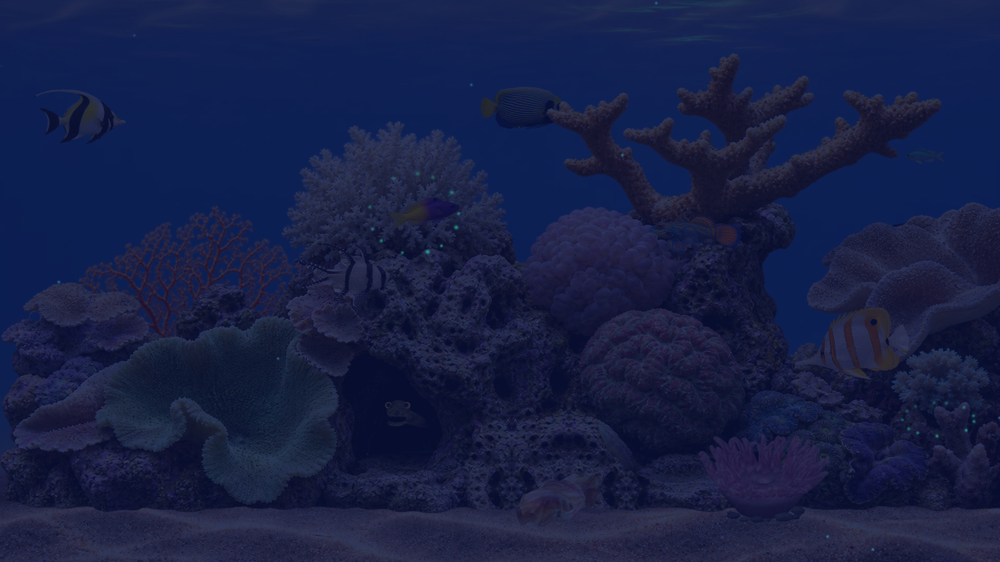

# Deep Reef

**[Download the ready-to-install Roku ZIP](https://github.com/christopher-weaver/roku-fish/raw/refs/heads/main/dist/deep-reef-screensaver.zip)** · [Step-by-step installation](INSTALL.md)

A connected, reference-aligned coral aquarium with larger fish, a shared rock foundation and sharp sand ridges. This is a self-contained native Roku aquarium screensaver with a pink, orange and red **Sunset** default, ten swimming fish species and a resident moray, autonomous three-dimensional movement and layered coral occlusion. It has no runtime network dependency, video playback, ordinary channel entry point, or Home-screen launch flow.

**Install:** upload `dist/deep-reef-screensaver.zip` to the Roku Developer Application Installer, then choose **Settings → Theme → Screensavers → Deep Reef → Set as screensaver**. Some firmware labels sideloaded screensavers **dev**. See [INSTALL.md](INSTALL.md).


The aquarium includes ocellaris clownfish, yellow tang, royal gramma, emperor angelfish, Moorish idol, blue-green chromis, regal blue tang, copperband butterflyfish, Banggai cardinalfish and mandarin dragonet. Medium now displays eight fish instead of eighteen. Each activation shuffles a unique-species roster. Higher-resolution fish canvases, denser meshes, rounded body contours, thin fin edges and normal-based shading improve the models. Fish body turns use 80 adaptive heading slots from 41 upright angles, retaining all 25 refined frontal samples and continuous interpolation. Tails and fins retain their independent 64-slot rigs; bilateral views share pixels without runtime reflection. The body mesh excludes the independently animated caudal tail, so only one tail is visible; pectoral fins also move independently. Body-only interpolation between neighboring 3D headings removes view snapping; tails and pectoral fins remain single independent images. A lateral 3D mesh bend moves the rear body from an S to an inverse S while keeping the forebody steady; swimming does not shift the body vertically. Angular acceleration and jerk are eased further. Fish favor long clear crossings, brake less at intermediate waypoints, and rarely pause. Under-fin textures use surrounding skin patterns instead of shifted stripes. Progress checks recover blocked routes using short, swept-clear 3D maneuvers. Depth-wall forces respect the front swimming lane, and passing lanes are checked against the reef before steering. Velocity easing and bounded cubic display interpolation soften movement; fins and tails use continuously changing pose envelopes while retaining single images.

The surface wave field is twice its previous width and height, using a two-dimensional rippling reflection field. It draws behind the animals, and conservative full-body clearance keeps fish below it.

Broad, feathered wave shading is stronger on the reef and sand, with a much subtler effect on fish. Its tilted projection makes cells smaller toward the back and larger in the foreground. Conservative receiver masks keep the open-water background unchanged. The photographed sand ridges remain visible.

Every coral/live-rock group now has a closed, phototextured 3D volume mesh. A deep, bending cave with modeled walls and a closed rear chamber follows the actual tunnel opening. The editable Blender scene includes the reef pieces, marine volumes and articulated moray. Roku displays their offline renders to keep native playback compact. The reef follows the supplied reference: touching bases on a nearly common line, a green cup at the left, a white crown over the center-left cave, tall antlers to the right, and smaller corals/clams along the foundation. The sea fan uses the restored, approved lacy appearance and its original slow animation. The anemone is modeled around the earlier picture: a visible mouth and fleshy oral disc, 64 thicker, tapered tentacles, now colored bright pink using the latest reference. Its individual fingers bend in three axes across 65 coherent poses. The complete anemone nests directly into the existing modeled reef, with a small broken border of natural stones and darker shading along its rounded edge, at a lower reef-aligned angle, with shorter fingers and photographic tissue maps, with 20% transparent tentacles. Moving caustic shading is disabled on both the fan and anemone. Sculpted bubble and brain coral use detailed reef textures wrapped over rounded geometry. Only one rendered view appears at a time. Their source meshes and the original Blender geometry are included. Each marine object draws as one coherent image. Runtime strip warps and camera-view snapping are removed; no pose crossfades are used.

The resident moray is modeled from geometry, with a moving jaw, spherical eyes/pupils, tiny teeth and a bending neck. Its smooth, irregular olive-brown skin mottling is attached to the model and uses no portrait texture or repeating lattice. Its smaller eyes sit closer to the head, and its lower jaw is thinner. The rear body remains anchored inside a wider cave while the head stays low, advances farther through the entrance, then lifts near the end into brighter surface light. Sixty-five emergence poses and thirty-two mouth/squint expression poses preserve real occlusion between the cave lip and animal, including when the head emerges in front of the lip. Free-swimming fish avoid a reserved 3D cave volume during spawning, route planning and swept movement checks.

The water/sand backgrounds were recreated after fixing the reef layout, with matching lighting, grain and contact shadows. The fixed reef textures draw at native design resolution. Extra layer resampling, coral-view blending and fish-pose crossfades are removed. Panning retains one final neighboring-pixel interpolation; exact 1:1 draws use DrawObject. Auto/High target 60 fps with an Auto 30 fps fallback; Performance targets 720p/30 fps. Actual Roku output still requires device checking.

A smaller, sideways-facing modeled clam uses photographic reef-matched shell/mantle textures and opens occasionally. Each opening has a 1-in-50 birth chance; other openings show a pearl or release a rising bubble cluster. Newborn fish use a species already loaded in the tank. The interior has a pale photographic tissue lining. Pearl and bubble contents are already present at full opacity behind the closed shell and revealed by its actual foreground mask. A baby is prepared inside the closed clam, moves continuously through its opening behind the foreground shell, and then joins normal swimming using the same object and collision rules as adults. At most four offspring are added per activation, with a total ceiling of twelve fish; later birth events reveal a pearl. Bubble events respect Bubble density → Off.

Choose **Lighting → Night** for dim blue water, softly pulsing blue-green coral emission and glowing plankton. Water particles → Off hides the plankton. Automatic lighting also enables this emission during its darkest hours.



The settings menu uses readable system fonts, a translucent highlight behind the text, and explicit Back/Done closure. Settings persist in the Roku registry: lighting (Sunset, Daylight, Dusk, Moonlight, Night, Automatic), 6/8/10-fish populations, camera Off/Subtle/Slow, bubbles, particles, movement, quality, clock, FPS, and Restore Defaults. Clock and FPS default off. Camera movement defaults to Slow, sweeping left to right and back over three minutes. Existing saved settings are retained; choose Camera movement → Slow to enable the widest sweep. Automatic uses the device's local time. All interaction belongs to the separate settings entry point.

## Build

The included runtime artwork is ready to use. Packaging requires **Python 3.10+ only**, with no image libraries or network access:

```sh
python tools/build.py
```

For a new release version:

```sh
python tools/build.py --increment
```

Optional deployment, after setting `ROKU_IP` and `ROKU_DEV_PASSWORD` in your shell:

```sh
python tools/deploy.py
```

The helper does not read `.env` automatically. `.env.example` documents the variable names; never commit actual credentials. Deployment replaces the device's single developer app. It was not attempted in this session because no Roku connection details were configured.

## Develop and verify

```sh
npm install
python -m pip install -r tools/requirements.txt
python tools/test.py --quick
```

`tools/test.py` compiles the native sources, runs package/asset checks, and executes production BrightScript simulation tests. The optional soak runs one simulated hour with six principal fish; it is a host test, not a Roku performance test. Device storage is represented by a small registry adapter in the host interpreter.

Regenerate the bundled artwork offline from checked-in sources:

```sh
python tools/generate_assets.py
python tools/build.py
```

Linux headless mesh rendering uses Mesa/EGL. See [ASSET_PIPELINE.md](ASSET_PIPELINE.md) for Windows/macOS alternatives and the optional Blender renderer.

For the interactive visual inspection recording:

```sh
python -m http.server 8000
```

Open `http://localhost:8000/docs/preview.html`. It displays snapshots exported from the real BrightScript brain, interpolated for inspection. The Roku ZIP contains no browser or server.

See [ARCHITECTURE.md](ARCHITECTURE.md), [PERFORMANCE.md](PERFORMANCE.md), [TESTING.md](TESTING.md) and [CREDITS.md](CREDITS.md).

**Validation boundary:** local compilation, direct simulation, asset checks, preview inspection and ZIP integrity are covered. Roku registration, actual GPU output, sustained 60/30 FPS, memory consumption, remote dismissal and reboot persistence require testing on a real device. The fish meshes are silhouette-derived textured volumes; a future artist can replace them with sculpted anatomical models using the supplied atlas interface. Camera travel deliberately uses 128 pixels of overscan instead of a stretched two-screen panorama.

## Keep the install ZIP on GitHub

`dist/deep-reef-screensaver.zip` is deliberately committed as a regular Git binary. It is available directly from this repository; it is not a Git LFS pointer or an expiring workflow artifact.

Whenever Roku sources or packaging change, rebuild and commit the release files with the source:

```sh
python tools/build.py
git add roku tools dist/deep-reef-screensaver.zip dist/build-report.json
python tools/check_release.py
git commit -m "Update aquarium and sideload package"
git push
```

For a new release version, use `python tools/build.py --increment` instead. The **Verify sideload ZIP** GitHub Actions workflow checks every push and pull request for a missing or stale package. `AGENTS.md` records the same requirement for future coding sessions.

## Version 1.0.2

Fixes the Roku shared-array iterator issue that advanced only the first fish. All 12/18/24 fish now update independently. Adds smoother swimming, moving pectoral fins, slimmer fish, larger bubbles, animated surface ripples, a wider slow camera sweep and more saturated reef colors. The host tests now emulate Roku’s single enumeration cursor so this device-specific regression cannot silently pass the JavaScript interpreter again.

## Version 1.0.3

Fixes invisible settings rows, fits the full menu on both 720p and 1080p screens, and repairs Back/Done exit handling. Prevents body, tail and fin clipping using fine per-layer coral masks, swept full-fish collision checks and early avoidance. Adds moving dappled sunlight on reef and sand, a 60 fps render target with stable automatic fallback, denser yaw/tail/fin poses, finer meshes and 3× supersampling. The tracked ZIP is rebuilt with every runtime change. Reef alpha plates use WebP with lossless alpha, supported since [Roku OS 9.4](https://developer.roku.com/dev/docs/media); this project targets modern Roku OS 16 devices.

## Version 1.0.4

Removes dappled reef lighting. A shared eight-second water-height cycle drives 32 rolling surface-wave frames and their moving sand caustics. Frozen caustic lines are softened out of the source sand photograph. Fish now have 32 yaw views, eight tail bends and nine pectoral-fin poses per yaw, rendered with 4× supersampling. Bubbles, surface waves, coral and light effects update on the interpolated display clock, and frame waiting occurs before the buffer swap. Avoidance and turn-speed changes ramp gradually. Native settings and full-fish coral collision handling are retained.

## Version 1.0.5

Keeps the existing pan rate and four-minute Slow cycle, but places scenery fractionally instead of rounding its travel to whole pixels. A startup pixel-readback check chooses a working floating-point drawing path and retains a safe fallback on unsupported hardware. The scene is rebuilt around the user's fuller, closer reef reference, with coral across the center and 60% larger fish. Higher-resolution fish textures retain 32 yaw views, eight tail bends and nine independent fin poses. Sand grain and defined ridges remain photographic; only a restrained light modulation changes with the waves. The rebuilt ZIP remains tracked and directly downloadable.


## Version 1.0.6

Replaces the two broad reef planes with eight independent mid-ground formations, a clean transparent reef source and clearance-validated routes through open water. Fish explore both sides of the reef rather than only repelling upward. Turning now uses 64 views with width-matched view blending, gentler angular acceleration and jerk, continuous display heading velocity, and GPU-probed fractional placement while pitched. Bilateral view reuse keeps decoded texture memory close to the previous release. The updated installation ZIP remains tracked on GitHub.

## Version 1.0.7

Fixes upside-down turns by replacing runtime reflections with 64 actual upright views. Body and pectoral poses now blend too. Replaces the large-anchor camera transform with adjacent-pixel blending of an opaque scene canvas, reduces frame-loop allocation/pathfinding work, and rebuilds the reef as six sparse islands with three rendered relief views each. The updated ZIP remains committed and directly downloadable.

## Version 1.0.8

Removes ghost-producing fish pose overlays and extra filtering. Rebuilds the reef as a touching, reference-aligned foundation rather than separate islands. Adds fish-style textured 3D fan/anemone volumes with seven sharp views each, and recreates the backgrounds around the fixed layout. The rebuilt ZIP remains tracked on GitHub.

## Version 1.0.9

Reduces density to 6/8/10 fish, adds four species (ten total), and shuffles a unique-species roster per activation. Improves fish volume contours, mesh density, render resolution and color detail, with a separate non-overlapping caudal-tail rig. Adds variable surface-wave shadows over the sand highlights. Loads only the species actually present. The refreshed installation ZIP remains tracked on GitHub.

## Version 1.0.10

Adds adaptive rendered body angles for smoother turns toward/away from the viewer: 1.40625° near head-on, and 0.703125° directly head-on, versus the previous 5.625°. Predictive, size-aware fish separation uses passing lanes, gradual braking, safe spawn placement and swept body/tail/fin envelopes that include pitch. Both marine objects now bend continuously with the display clock, with pinned roots and extra collision clearance for moving tips. The refreshed ZIP remains tracked on GitHub.

## Version 1.0.11

Refines fish turns to 112 heading slots and makes swimming predominantly lateral, with home-depth routes and side-facing hover poses. Replaces the seam-prone marine strip renderer with 65 complete, root-pinned 3D mesh poses per object. Adds a slightly goofy moray peeking from the real lower tunnel, with slow eased emergence, retreat and pauses. Speeds Slow panning from four minutes to three and adds a soft, animated cellular wave-net shadow over the entire scene. The updated ZIP remains tracked on GitHub.

## Version 1.0.12

Replaces the moray portrait with an original articulated 3D model and 25 rendered poses. Converts the remaining reef groups into closed UV-textured volume meshes and models a hollow tunnel that follows the existing opening. Includes a complete editable Blender source scene. Replaces the full-screen net with broad, perspective-projected surface shading: coral and sand use conservative receiver masks, while fish and animated objects receive matching wave lighting. Open water stays clear. The refreshed ZIP remains committed on GitHub.

## Version 1.0.13

Darkens ground/reef wave shading by 20% and reduces the wave modulation on fish to 36% of its previous strength. Rebuilds the tunnel as a bending blind cave with a closed rear chamber. The moray stays anchored inside that geometry and emerges through its opening using 65 joint depth-tested states. Removes the sliding portrait placement and background repair patch. Adds a swept 3D cave reservation for all free swimmers and rebuilds their routes. The install ZIP remains tracked on GitHub.

## Version 1.0.14

Closes and rounds the fish body joins, fixes overlapping perimeter faces, and wraps body colours through the edges. Adjusts the moray's lower path, late lift and longer reach; reduces its eyeballs by 31%; widens the chamber and removes the artificial bright floor line. Adds a textured, ridged 3D floor and solid rock footings with swept fish clearance, preventing under-reef/sand emergence. Replaces projected marine surfaces with modeled tentacles and rounded sea-fan branches, and adds sculpted, textured bubble/brain coral geometry. The editable Blender scene and updated install ZIP remain included on GitHub.

## Version 1.0.15

Restores the earlier sea fan exactly. Rebuilds the anemone around the approved flower-like form, with one hundred curled 3D tentacles, rounded peach tips, a recessed mouth and reference-matched surface colors. The eel emerges farther into the light, occasionally opens his jaw, and sometimes makes a squinting, lopsided grin. His smaller eye size is preserved. Spawn correction uses a clear navigation node if the extended eel occupies both usual depth lanes. The refreshed install ZIP remains tracked on GitHub.

## Version 1.0.16

Changes the anemone to 64 thicker, tapered pink-and-cream fingers based on the new photograph. Replaces the eel’s repeating skin pattern with soft, irregular mottling and fine surface variation fixed to the animal. Adds continuous tail-synchronized whole-body sway without stretching the fish or adding draw passes. Fixes excessive obstacle braking, lost neighbor steering near coral, blocked passing lanes, and routed fish that never recover. Stalled fish choose a clear escape route without teleporting; recovery checkpoints are staggered. The updated install ZIP remains tracked on GitHub.

## Version 1.0.17

Adds traveling S-curve fish swimming, gentler turning and context-matched skin under the pectoral fins. Shortens and tilts the softly translucent anemone, removes moving light modulation from it and the sea fan, and thins the eel’s lower jaw. Adds an articulated clam with pearl, bubble and live-fish events, plus selectable Night bioluminescence. Replaces surface ribbons with rippling reflections confined above the fish’s complete swimming outline. The updated sideload ZIP and build report remain tracked in GitHub.

## Version 1.0.18

Replaces the anemone and clam’s smooth materials with photographic tissue/shell detail from the approved reef artwork. Anemone tentacles have 80% opacity. The clam is 30% smaller in 3D and rotated 55° toward the side, with a narrower screen footprint. A baby exists inside the closed shell and emerges behind a geometry-derived foreground mask before joining free swimming. Body-only heading interpolation and gentler steering make turns continuous. Long clear lateral crossings, less waypoint braking and shorter rare pauses keep fish moving through the scene. Surface reflections are stronger and retain full fish clearance. The refreshed ZIP remains tracked on GitHub.

## Version 1.0.19

Repairs depth-boundary deadlocks and stalled escape maneuvers, adds velocity easing and cubic display positions, and smooths single-image fin/tail pose transitions. A three-minute, 5,400-tick production-logic baseline reproduces the old stalls; a one-minute follow-up and targeted native regressions validate the recovery fixes. Adds a reef pocket and foreground rim (replaced by the complete-base platform in 1.0.20). Replaces the clam's dark lining and prepares pearl, bubbles and babies behind the closed shell; shell geometry reveals them as it opens. Doubles the surface wave field's width and height while preserving fish clearance. The sideload ZIP and build report remain tracked on GitHub.

## Version 1.0.20

Restores the anemone's full original pedal column and removes the foreground rim that cut across it. A closed, irregular rock platform now sits behind and beneath the complete animal, with settled sand on the ledge and a feathered apron matching the photographed seabed. Updated source geometry, Blender materials, collision masks, screenshot and sideload ZIP are included.

## Version 1.0.21

Adds a small raised rock lip around the anemone's foot and brings the ledge forward slightly so the complete animal is visibly supported. The original anemone model and animated texture remain unchanged. The new lip is part of the closed platform geometry, with the same rock texture and sand transition. Updated screenshot, Blender source and sideload ZIP are included.

## Version 1.0.22

Changes the narrow anemone lip to neutral, finely grained stone without projected coral colours. Adds a gradual static shadow to the lower pedal column and a soft contact shadow on the receiving rock. The complete geometry and tentacle opacity are preserved. Updated materials, Blender source, screenshot and installation ZIP are included.

## Version 1.0.23

Removes the formal rim and separate support slab. Following the supplied reference, the complete anemone attaches directly to the existing reef rock, with outer front tentacles curving down over the stem and rock-to-sand transition. Its fingers retain their independent 3D tip motion and translucency. Updated geometry, Blender scene, screenshot and install ZIP are included.

## Version 1.0.24

Removes the downward side/front tentacle extensions. Adds a small border of separate, irregular 3D rock fragments around the foot. Geometry-based edge shading darkens the base perimeter and gives the tentacles a gentler rounded edge. The complete base, original crown animation and tentacle opacity are retained. Updated Blender geometry/materials, screenshot and sideload ZIP are included.

## Version 1.0.25

Colors the anemone bright pink using a reference-inspired palette while retaining photographic tissue detail, edge shading, translucency and the approved shape. The small stone border now mixes larger rocks with small infill pieces, with varied dimensions and less regular spacing. Updated materials, Blender source, screenshot and installation ZIP are included.

## Version 1.0.26

Fixes the long-standing full-resolution offscreen canvas in Performance mode, removes empty shadow passes, and crops receiver maps without changing visible shadow pixels. Reduces repeated fish-bending trigonometry while preserving the eight-section curve and body-view blending. Adds native update/draw/swap/event timings to the FPS display and developer console. See [the performance investigation](docs/PERFORMANCE.md) for measured workload reductions and the remaining device-validation step. Updated source and sideload ZIP remain tracked on GitHub.

## Version 1.0.27

Responds to the Roku Ultra's U101/D31 timing evidence by reducing update CPU work: exact indexed reef queries, shared sweep geometry, cached body envelopes and early fish-pair rejection. The same two-second production fixture retains every collision check and all eight fish trajectories while making 75% fewer BrightScript helper calls and 92% fewer occupancy string searches. Fixed 30 Hz motion, fish detail and density are retained. The updated ZIP is included; [the investigation](docs/PERFORMANCE.md) distinguishes measured work reductions from the pending native FPS recheck.

## Version 1.0.28

Further reduces update and fish-rendering math after the Ultra's 11 FPS / U44 / D30 result. Keeps the 30 Hz simulation and reference fish motion while removing 35% of the remaining update helper calls; the production draw fixture uses 65% fewer Sin/Cos calls with unchanged draw count and heading blending. Fixes body-section pivot placement at the pitch limit and adds height-based, filter-safe overlap to prevent swim-wiggle gaps. The sideload ZIP is updated and tracked; [the investigation](docs/PERFORMANCE.md) documents validation and the pending device FPS sample.

## Version 1.0.29

Replaces segmented fish bodies with complete curved/neutral/inverse-curved images for all 112 turning views, removing internal slice joins. Keeps exact visible texture colors, independent fins/tails, and continuous pose/yaw blending. The native 120-frame fixture drops from 2,160 to 707 transforms. Shared anatomy caches reduce update field reads by 13% without changing the reference fish positions or collision checks. The updated ZIP uses the 4 MiB package ceiling and remains tracked on GitHub. [Performance details and validation](docs/PERFORMANCE.md).

## Version 1.0.30

Attaches each tail at its actual shared mesh joint, preserves neck thickness while the tip animates, and paints the tail root beneath the body. Fixes crop-driven root drift and matches the body's rounded origin on integer-only graphics backends. No extra draw calls or texture changes. Checks cover ten species, eight headings, eight swim phases, HD/FHD and both placement paths. The ZIP is updated and tracked; [joint validation and matching close-ups](docs/tail-attachment-audit.json).

## Version 1.0.31

The copperband butterflyfish's tail bend now sits farther back on its narrow tail stalk, behind the dorsal and anal fins. Its body/tail mesh partition, rendered views and shared attachment were rebuilt together. This keeps the rear fins on the body and retains the continuous tail join without adding runtime work. To rebake this species from the existing approved mesh and textures, run `python tools/rebind_tail.py copperband_butterflyfish` with the artwork dependencies installed.

## Version 1.0.32

Moves the copperband tail joint farther back again, from source U=0.15 to U=0.11. Reduces density-dependent CPU work with conservative early rejection of distant swept fish pairs, squared-distance neighbor screening, direct complete-body submissions, and shared rotation bases. The existing phase/yaw blend and draw count are retained. Clam births now have an independent 2% chance per opening, with the existing population caps. The updated install ZIP is tracked. See [performance measurements](docs/density-performance-audit.json).

## Version 1.0.33

Replaces vertical swim-image warps with real lateral mesh poses and reviews all ten species' thicknesses. Reduces decoded artwork from 171.58 to 142.54 MiB, releases 8,160 JSON frame objects after loading, creates only the graphics regions used by the detected backend, reuses steering/render scratch objects, and memoizes exact reef-cell queries in fixed-size caches. A small swept-contact margin prevents near-contact precision drift. Memory recovery notifications no longer force garbage collection, and Auto can recover 60 Hz after sustained measured headroom. The FPS overlay adds N (fish count) and M (app memory percentage when supported). The updated ZIP is tracked. [Anatomy and animation](docs/FISH_ANATOMY.md) · [Performance evidence](docs/sustained-performance-audit.json).
