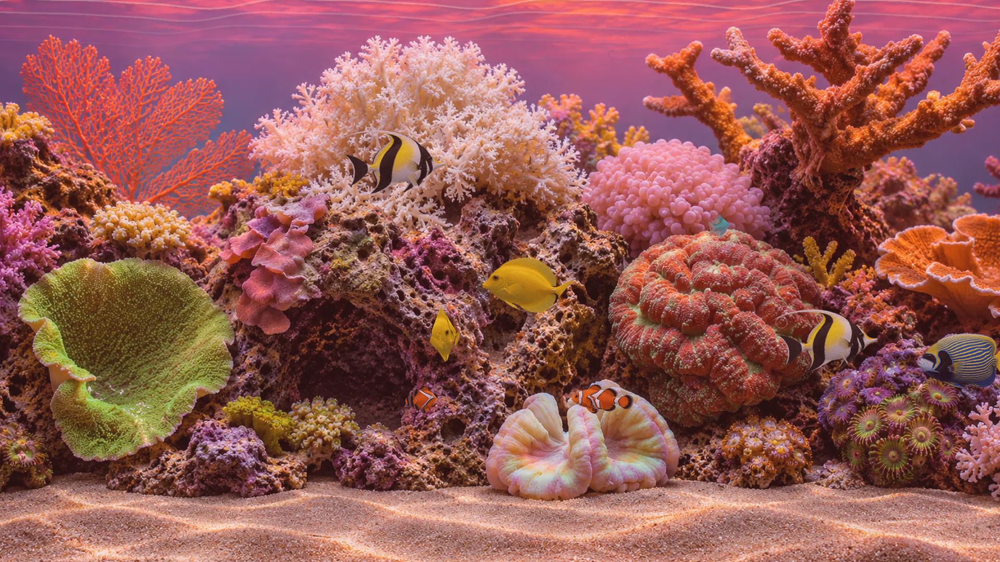

# Deep Reef

**[Download the ready-to-install Roku ZIP](https://github.com/christopher-weaver/roku-fish/raw/refs/heads/main/dist/deep-reef-screensaver.zip)** · [Step-by-step installation](INSTALL.md)

A close-view, continuous coral reef aquarium with larger fish and sharp sand ridges. This is a self-contained native Roku aquarium screensaver with a pink, orange and red **Sunset** default, six marine species, autonomous three-dimensional movement and layered coral occlusion. It has no runtime network dependency, video playback, ordinary channel entry point, or Home-screen launch flow.

**Install:** upload `dist/deep-reef-screensaver.zip` to the Roku Developer Application Installer, then choose **Settings → Theme → Screensavers → Deep Reef → Set as screensaver**. Some firmware labels sideloaded screensavers **dev**. See [INSTALL.md](INSTALL.md).



The aquarium includes ocellaris clownfish, yellow tang, royal gramma, emperor angelfish, Moorish idol and blue-green chromis. Each has 32 mesh-rendered yaw orientations, eight body/tail poses, and nine independently animated pectoral-fin poses per view. Bodies retain their slimmer proportions and now appear 60% larger. The three larger species use 224×196 rendering canvases; the others use 208×182, with sharper photographic textures. Fish cruise, explore, hover, hide, turn and loosely school. Depth changes their scale, apparent speed, tint and position relative to two transparent reef surfaces. Soft coral moves; wave-driven sand caustics, light shafts, a rolling wave surface, particles and larger sparse bubbles animate independently. Fixed simulation ticks, interpolated fish and bubble positions, continuous effect timing and gradually applied avoidance keep swimming smooth. Frame waiting occurs before presentation so a blocking buffer swap does not delay the next render. Auto/High target 60 fps; Auto settles at 30 fps if the device cannot sustain it. Performance targets 30 fps at 720p. Full fish footprints and swept movement stay clear of both coral layers, including during camera travel. The reference-inspired reef fills the middle and both sides of the frame, and the original sharp sand-ridge detail is retained under subtle wave-linked lighting.

The settings menu uses readable system fonts, a translucent highlight behind the text, and explicit Back/Done closure. Settings persist in the Roku registry: lighting (Sunset, Daylight, Dusk, Moonlight, Automatic), 12/18/24-fish populations, camera Off/Subtle/Slow, bubbles, particles, movement, quality, clock, FPS, and Restore Defaults. Clock and FPS default off. Camera movement defaults to Slow, sweeping left to right and back over four minutes. Existing saved settings are retained; choose Camera movement → Slow to enable the widest sweep. Automatic uses the device's local time. All interaction belongs to the separate settings entry point.

## Build

The included runtime artwork is ready to use. Packaging requires **Python 3.10+ only**, with no image libraries or network access:

```sh
python tools/build.py
```

For a new release version:

```sh
python tools/build.py --increment
```

Optional deployment, after setting `ROKU_IP` and `ROKU_DEV_PASSWORD` in your shell:

```sh
python tools/deploy.py
```

The helper does not read `.env` automatically. `.env.example` documents the variable names; never commit actual credentials. Deployment replaces the device's single developer app. It was not attempted in this session because no Roku connection details were configured.

## Develop and verify

```sh
npm install
python -m pip install -r tools/requirements.txt
python tools/test.py
python tools/test.py --soak
```

`tools/test.py` compiles the native sources, runs package/asset checks, and executes production BrightScript simulation tests. The optional soak runs one simulated hour with six principal fish; it is a host test, not a Roku performance test. Device storage is represented by a small registry adapter in the host interpreter.

Regenerate the bundled artwork offline from checked-in sources:

```sh
python tools/generate_assets.py
python tools/build.py
```

Linux headless mesh rendering uses Mesa/EGL. See [ASSET_PIPELINE.md](ASSET_PIPELINE.md) for Windows/macOS alternatives and the optional Blender renderer.

For the interactive visual inspection recording:

```sh
python -m http.server 8000
```

Open `http://localhost:8000/docs/preview.html`. It displays snapshots exported from the real BrightScript brain, interpolated for inspection. The Roku ZIP contains no browser or server.

See [ARCHITECTURE.md](ARCHITECTURE.md), [PERFORMANCE.md](PERFORMANCE.md), [TESTING.md](TESTING.md) and [CREDITS.md](CREDITS.md).

**Validation boundary:** local compilation, direct simulation, asset checks, preview inspection and ZIP integrity are covered. Roku registration, actual GPU output, sustained 60/30 FPS, memory consumption, remote dismissal and reboot persistence require testing on a real device. The fish meshes are silhouette-derived textured volumes; a future artist can replace them with sculpted anatomical models using the supplied atlas interface. Camera travel deliberately uses 128 pixels of overscan instead of a stretched two-screen panorama.

## Keep the install ZIP on GitHub

`dist/deep-reef-screensaver.zip` is deliberately committed as a regular Git binary. It is available directly from this repository; it is not a Git LFS pointer or an expiring workflow artifact.

Whenever Roku sources or packaging change, rebuild and commit the release files with the source:

```sh
python tools/build.py
git add roku tools dist/deep-reef-screensaver.zip dist/build-report.json
python tools/check_release.py
git commit -m "Update aquarium and sideload package"
git push
```

For a new release version, use `python tools/build.py --increment` instead. The **Verify sideload ZIP** GitHub Actions workflow checks every push and pull request for a missing or stale package. `AGENTS.md` records the same requirement for future coding sessions.

## Version 1.0.2

Fixes the Roku shared-array iterator issue that advanced only the first fish. All 12/18/24 fish now update independently. Adds smoother swimming, moving pectoral fins, slimmer fish, larger bubbles, animated surface ripples, a wider slow camera sweep and more saturated reef colors. The host tests now emulate Roku’s single enumeration cursor so this device-specific regression cannot silently pass the JavaScript interpreter again.

## Version 1.0.3

Fixes invisible settings rows, fits the full menu on both 720p and 1080p screens, and repairs Back/Done exit handling. Prevents body, tail and fin clipping using fine per-layer coral masks, swept full-fish collision checks and early avoidance. Adds moving dappled sunlight on reef and sand, a 60 fps render target with stable automatic fallback, denser yaw/tail/fin poses, finer meshes and 3× supersampling. The tracked ZIP is rebuilt with every runtime change. Reef alpha plates use WebP with lossless alpha, supported since [Roku OS 9.4](https://developer.roku.com/dev/docs/media); this project targets modern Roku OS 16 devices.

## Version 1.0.4

Removes dappled reef lighting. A shared eight-second water-height cycle drives 32 rolling surface-wave frames and their moving sand caustics. Frozen caustic lines are softened out of the source sand photograph. Fish now have 32 yaw views, eight tail bends and nine pectoral-fin poses per yaw, rendered with 4× supersampling. Bubbles, surface waves, coral and light effects update on the interpolated display clock, and frame waiting occurs before the buffer swap. Avoidance and turn-speed changes ramp gradually. Native settings and full-fish coral collision handling are retained.

## Version 1.0.5

Keeps the existing pan rate and four-minute Slow cycle, but places scenery fractionally instead of rounding its travel to whole pixels. A startup pixel-readback check chooses a working floating-point drawing path and retains a safe fallback on unsupported hardware. The scene is rebuilt around the user's fuller, closer reef reference, with coral across the center and 60% larger fish. Higher-resolution fish textures retain 32 yaw views, eight tail bends and nine independent fin poses. Sand grain and defined ridges remain photographic; only a restrained light modulation changes with the waves. The rebuilt ZIP remains tracked and directly downloadable.
