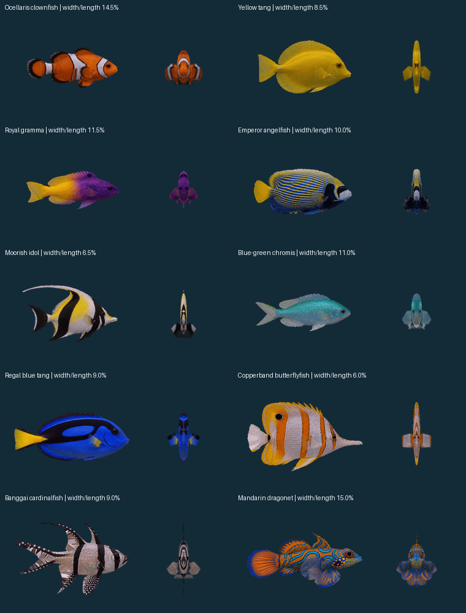

# Fish anatomy and lateral swimming — 1.0.34

The former swim atlas shifted image columns in screen Y. That made the rear body move vertically. Complete body poses now come from the textured volume mesh, bending in model Z (left/right), before yaw projection. Model Y stays fixed. The forebody remains steady and the rear body forms an S and inverse S. Caudal deflection continues the rear-body S curve with the matching opposite stroke. Tails bind to the projected 3D attachment; no vertical swim tangent is applied to the tail or pectoral image.

The widths below are measured model extents: maximum left/right body width divided by tip-to-tip model length. The targets are visual modeling choices informed by species/family morphology, not published specimen measurements or a claim of exact biological ratios. They distinguish compressed tangs, angels, butterflies and idols from fuller clownfish/grammas and cylindrical dragonets. Peripheral fins remain thin. Existing conservative collision padding is retained.

| Species | Previous width/length | Revised width/length |
| --- | ---: | ---: |
| Ocellaris clownfish | 35.9% | 14.5% |
| Yellow tang | 25.3% | 8.5% |
| Royal gramma | 27.3% | 11.5% |
| Emperor angelfish | 26.0% | 10.0% |
| Moorish idol | 20.9% | 6.5% |
| Blue-green chromis | 29.5% | 11.0% |
| Regal blue tang | 20.5% | 9.0% |
| Copperband butterflyfish | 17.5% | 6.0% |
| Banggai cardinalfish | 18.5% | 9.0% |
| Mandarin dragonet | 24.3% | 15.0% |

The prior thickness coefficient did not directly express width/length: cropped mesh spans differed by species. The review measured actual vertices and rescales Z explicitly, then transforms the normals and rebakes body, tail and fin views. Side profiles retain their shape.

The atlas retains all 25 refined frontal samples from 78.75° through 101.25°. Profile views use wider spacing, with continuous yaw and phase interpolation. There are 80 heading slots from 41 unique angles, three complete body poses, and independent 64-slot tails and fins. Reverse-side body slots reverse bend phase rather than reflecting the image. Texture dimensions and lossless encoding are retained.

Validation checks every species' width ratio and mesh coordinates: opposite swim poses have identical X/Y and opposite Z displacement. Rendered profile silhouettes retain their vertical row coverage. Production tail/whole-body tests also run after the raw frame metadata has been released.

[Animated production-draw reconstruction](previews/lateral-swim.gif) — a host reconstruction, not a Roku screenshot.

## Morphology references

- [University of Michigan, Acanthuridae](https://animaldiversity.org/accounts/Acanthuridae/): deep, compressed tang/surgeonfish bodies.
- [University of Michigan, Chaetodontidae](https://animaldiversity.org/accounts/Chaetodontidae/): deep, laterally compressed butterflyfish bodies.
- [USGS, Moorish idol](https://nas.er.usgs.gov/queries/factsheet.aspx?SpeciesID=2303): strongly compressed body.
- [FAO, emperor angelfish](https://www.fao.org/4/y0770e/y0770e50.pdf): deep, laterally compressed oval body.
- [National Museum of Nature and Science, ocellaris clownfish](https://www.kahaku.go.jp/research/db/zoology/Fishes_of_Andaman_Sea/contents/pomacentridae/11.html): moderately deep, compressed body.
- [University of Michigan, Pomacentridae](https://animaldiversity.org/accounts/Pomacentridae/): oval, laterally compressed damselfish forms.
- [FishBase, Banggai cardinalfish](https://www.fishbase.org/summary/Pterapogon_kauderni.html): compressed cross-section.
- [Monaco Nature Encyclopedia, mandarinfish](https://www.monaconatureencyclopedia.com/synchiropus-splendidus/?lang=en): cylindrical body.
- [University of Hawaii, fish structure and swimming](https://manoa.hawaii.edu/exploringourfluidearth/biological/fish/structure-and-function-fish): lateral muscle contraction and caudal propulsion.

Rebuild artwork with `python tools/whole_swim.py`; it uses the approved source meshes/textures and `tools/lateral_swim.py`. This is offline work; the Roku renders prebuilt regions.

## 1.0.34 articulation and eyes

The lateral S-curve coefficient is now 5.5% of model length, with the trunk bend starting 28% of the way back from the head; the caudal fin retains its separate rig and stroke. A small head counter-sway makes that depth movement visible in profile. C-turn poses use a smooth, one-sided quadratic bend up to 6.5% of length and follow signed, eased yaw velocity. S motion eases through neutral before the C bend grows; both transitions stay within four body draws. Neither curve changes model Y. Anatomical width targets above remain unchanged; collision depth additionally reserves the bend envelope.

Every fish has two actual ellipsoidal eyeball meshes, positioned on its photographed eye centers. Iris/pupil textures use the existing photographs. The copperband's false eyespot remains a skin marking; its true eye is modeled on the head. Fine frontal S views retain all 25 samples. Retained sprites keep their native resolution; the atlas adds C poses while removing redundant side views. Projected pitch scales continuously with yaw instead of switching signs at front/rear views.
